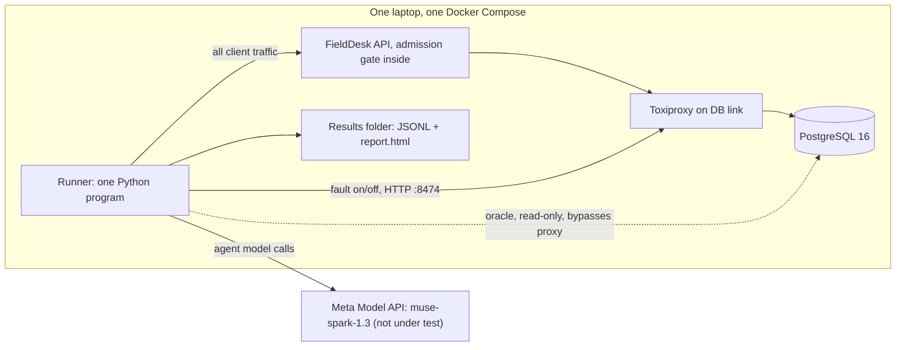
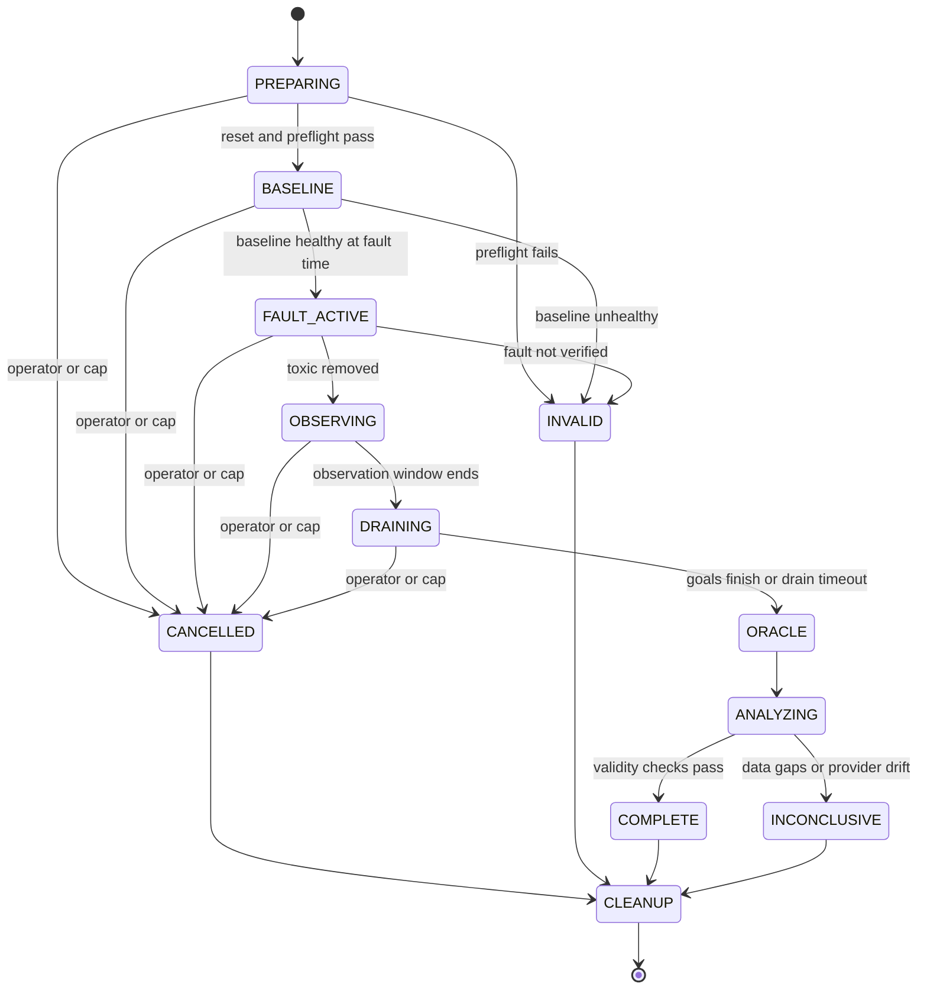

# Rebound — Agent Recovery Gate: Design Specification

> **Note for builders:** this is the full design specification, exported October 27, 2026. The project now uses a lean one-laptop build. Where this document disagrees with `docs/spec.md` (two laptops, the control API and web UI, cost-weighted gate, seven retry classes, metastability classes, DuckDB/Parquet, client-managed history), **`docs/spec.md` wins**.

Oct 27, 2026 · @Sasi

## 1. Executive decision and product definition

Build Rebound as a reproducible recovery gate for one API, one agent workflow and one fault — not as a load-testing platform. It answers one question: at an ordinary operating load, does a real tool-using agent population delay an API's recovery after a brief dependency fault, compared with a competent scripted client and a non-reactive replay, and does one server-side gate improve recovery without discarding useful work? Any of three outcomes — agents recover worse, similarly, or better — is a valid result.

### What it does, in plain language

Rebound runs real AI agents doing a real business task against your API in a lab you own. While they work, it slows your database for ten seconds. It records every visible agent decision, every HTTP attempt and every backend sample, then measures when — or whether, within a fixed window — the API returns to normal service. It repeats the same experiment with a careful hand-written client and with a blind replay of recorded traffic. Finally it turns on one admission gate and checks, with fresh agents, whether recovery improves while correctly completed tasks are preserved. An independent oracle checks every task against the database; no language model grades anything.

### User, decision, input, output

| Item | Definition |
| --- | --- |
| User | The owner of an API that AI agents call or will call: a backend, platform or SRE lead |
| Decision supported | "Is it safe to expose this API to agent clients at our expected load, and should we enable this admission gate with these parameters?" |
| Input | A containerized backend with pinned resources; a tool manifest mapping agent tools to endpoints; a task manifest of business goals with expected outcomes; an experiment manifest (arrival schedule, fault schedule, conditions, gate settings, model settings) |
| Output | An evidence bundle per trial: raw events, backend time series, oracle verdicts, a pre-registered recovery verdict per condition, a comparison table across conditions, the gate's measured effect, model usage and cost, and a short report |
| Action that follows | Enable or tune the gate; change timeout or Retry-After behavior; add capacity headroom; or record that agent clients need no special handling for this workflow |

### Useful product versus interesting experiment

An interesting experiment asks whether agents behave differently from scripts. A useful product answers, for a specific API and agent workflow, whether recovery protection works — with evidence that can be rerun before each release. The MVP is the experiment executed with product discipline: versioned manifests, a frozen protocol, a deterministic oracle, a gate verdict, and an evidence bundle another developer can re-analyze.

### What the MVP claims, and what it does not

| Claims (only if measured) | Does not claim |
| --- | --- |
| For this backend, workflow, model, prompt, load level and fault, the recovery outcome of each client condition across a stated number of repeated trials | That AI agents in general amplify load or delay recovery |
| How agent decisions during and after the fault changed backend work, attributed to visible actions | That any real-world outage was caused by autonomous agent reasoning |
| Whether the admission gate changed recovery time, correct goals and background service on fresh agent runs, including one condition not used for tuning | Production readiness, or results for other models, prompts, workflows or backends |
| Model usage and cost per trial | A globally smallest failure trigger, or that a simulator represents agents at larger scale |

## 2. Problem evidence and competing solutions

The mechanism Rebound tests is established; what is missing is measured evidence about how live tool-using agents behave as clients during a backend fault. Every tool below already does part of the job, so Rebound's contribution is narrow: a controlled comparison of client populations with independently verified outcomes and a validated gate.

### Problem evidence

| Evidence | What it establishes | What it does not establish |
| --- | --- | --- |
| GitHub's 2024–2026 availability decline, reconstructed from GitHub's own postmortems in a [peer-reviewed case study](https://www.mdpi.com/1999-5903/18/7/377): on Feb 9 2026, updated client applications raised read traffic more than tenfold, and GitHub lacked granular controls to shed the offending traffic | Client-side traffic changes can push a shared dependency into prolonged failure; the study classifies AI-era traffic as trigger and amplifier, with pre-existing architecture as root cause | That autonomous agent reasoning caused any GitHub incident; the "client applications" are not shown to be agents |
| The same study's model of retry amplification and its citation of metastable-failure research (Bronson et al., HotOS 2021; Huang et al., OSDI 2022) | Retries that sustain load after the trigger ends are a known route to failures that outlive their cause | Anything about agents specifically |
| [LIMBO](https://arxiv.org/pdf/2609.29095) (Sept 2026): deterministic sandbox of six services and twelve boundary faults, graded on a committed-effect ledger | Agents react to tool faults in measurable, model- and harness-dependent ways; outcome ledgers beat LLM judges | Backend load or recovery effects |
| AgentChaos (ASE 2026, [summary](https://www.developersdigest.tech/blog/agentchaos-fault-injection-agent-robustness)): HTTP-layer faults injected into live agent systems; every system tested degraded | Agents are sensitive to faults on their own dependencies | Effects on the systems agents call |

### What existing tools already do

| Tool | Verified capability | What Rebound might add | Overlap risk |
| --- | --- | --- | --- |
| Locust | Python user classes with arbitrary logic, wait-time helpers such as `constant_throughput` and `constant_pacing`, and custom `LoadTestShape` profiles ([docs index](https://docs.locust.io/en/2.37.1/genindex.html)). Scripted users can react to errors however the author codes them | Client decisions that come from a model rather than an author's guess; per-goal oracle verdicts; a recovery verdict | High: Rebound's own scripted control is effectively a careful Locust-style user |
| k6 | Open-model arrival-rate executors start iterations at a configured rate regardless of response time and report `dropped_iterations` when the system slows ([k6 docs](https://grafana.com/docs/k6/latest/using-k6/scenarios/concepts/arrival-rate-vu-allocation.md)); thresholds for pass/fail | The same open-arrival discipline applied to business goals executed by agents | High for arrival design; none for agent behavior |
| Toxiproxy | TCP proxy with latency (± jitter), bandwidth, slow\_close, timeout and slicer toxics, controlled over an HTTP API on port 8474 ([README](https://github.com/ik-infrastructure-testing/toxiproxy/blob/main/README.md)) | Nothing: Rebound uses it as its fault injector | None claimed |
| Antithesis | Deterministic simulation that injects faults, validates properties and reproduces failures exactly ([Pulse 2.0](https://pulse2.com/antithesis-105-million-series-a/)); the workload is code the developer supplies | Live, non-deterministic model clients calling an external provider — which, by inference, sits poorly inside a deterministic hypervisor | Medium: a stronger engine for scripted workloads; complementary |
| Agent fault injectors: AgentChaos, MCP-Injector ([NeurIPS 2026](https://neurips.cc/virtual/2026/poster/151564)), AgentCheck ([paper](https://huggingface.co/papers/2607.11098.md)), Flakestorm ([PyPI](https://pypi.org/project/flakestorm/)) | Inject faults into an agent's tools or model calls and score the agent's task robustness | Reverses the direction: measures the backend's recovery under agent clients | Medium: same fault-proxy idea, different system under test |
| Havoc | Verification pending: no agent-reliability tool by that name could be located; packages named Havoc found are a Chaos Mesh Go library and a .NET chaos library | — | Unknown |
| LIMBO | Exactly-once correctness of agent side effects under boundary faults, across models and harnesses | Availability and recovery of the backend, with correctness as a guardrail | Medium: adopt its ledger-based grading; do not compete on exactly-once |
| XPerf ([arXiv 2608.20370](https://arxiv.org/abs/2608.20370)) | Load-tests LLM serving systems by replaying traced agentic workloads; does not benchmark host-side agent logic or tool execution | Targets the tool-side backend, not the model server | Low |

### Narrowest defensible contribution

A reproducible protocol and harness that measures, for a given API and agent workflow, how live tool-using agents' observed reactions to a brief dependency fault affect backend recovery — relative to a competent adaptive script and a non-reactive replay — with oracle-verified task outcomes and one server-side gate validated on fresh agent runs.

**Strongest argument that it is insufficiently differentiated:** a competent engineer can write adaptive Locust users and add a Toxiproxy fault in a day. If agents turn out to behave like one more retry policy, Rebound reduces to existing tools driven by expensive clients, and a single workflow and model cannot generalize. The answer is evidence, not features: observed rather than guessed client policy, verified task outcomes, and a gate verdict a team can act on.

## 3. Demonstration scenario

The workflow is rescheduling a field-service technician visit (for example, an internet installation) on a purpose-built backend called FieldDesk. It offers several legitimate paths of very different cost, a harmless write, and a success condition the database can verify without any model.

### The business goal

"Customer C wants appointment A moved to any open slot between dates D1 and D2, same service type, with a technician qualified for that service in the customer's region." A small share of goals is deliberately infeasible (no qualifying slot exists); the correct outcome there is to defer without writing.

### Tools and endpoints

| Tool | Endpoint | Expected relative cost (to be measured on Day 2) | Legitimate use |
| --- | --- | --- | --- |
| `get_customer_appointments` | `GET /customers/{id}/appointments` | Cheap, indexed | Find the appointment to move |
| `get_appointment` | `GET /appointments/{id}` | Cheap | Read current state; verify after writing |
| `check_day_availability` | `GET /availability?region=&date=&service=` | Cheap to moderate, one region and day | Narrow search, one day at a time |
| `search_availability` | `GET /availability/search?service=&from=&to=&regions=` | Expensive: multi-day, multi-region join over slots, technician skills and region coverage, ranked by travel distance | Broad search when flexible; also a valid fallback |
| `list_technicians` | `GET /technicians?region=&skill=` | Moderate | Extra read when unsure about qualification |
| `reschedule_appointment` | `POST /appointments/{id}/reschedule` with `slot_id` and idempotency key | Write in one transaction; 409 if the slot was taken | Complete the goal |
| `defer_goal` | Harness-only, no backend call | None | Abandon or defer with a reason |

An agent can legitimately retry a failed lookup, switch from day-by-day checks to the broad search, broaden the date range or regions, re-read the appointment, restart the goal from the first lookup, or defer. **None of these behaviors is hardcoded.** The prompt describes the goal and the tools; it says nothing about retry strategy beyond one fixed, disclosed sentence that tools may occasionally fail or be slow.

The hypothesis that a failed cheap lookup pushes agents toward the expensive broad search is tested, not built in. The scripted control has the same fallback available (section 8), so if both use it equally, there is no agent-specific finding.

### Independent success condition

The oracle reads final database state directly, bypassing the fault proxy, and checks each goal against the task manifest:

1. Feasible goal: appointment A is `scheduled` in a slot dated within \[D1, D2\], with matching service type, a technician holding the required skill and covering the region, and no other active appointment in that slot.
2. Exactly one effective reschedule per goal (the change log has at most one applied change for A); no other appointment of customer C changed.
3. Infeasible goal: appointment A unchanged and the harness recorded a deferral.
4. Anything else is incorrect, duplicate, unfinished or failed, as defined in section 9.

Goals use disjoint customers, regions and slot pools, so concurrent goals cannot steal each other's slots and the expected outcome set is computable before the run. Background traffic is read-only.

### Backend selection strategy

**Decision: write FieldDesk during the event** (FastAPI, PostgreSQL 16, roughly 600–900 lines plus a seeded data generator). It is fully controllable, observable and harmless, and the new-work rule favors code written during the hackathon.

The risk is the accusation that the backend was built to break. Four rules defend against it:

- No artificial delays anywhere in the request path; a CI check rejects `sleep` calls in backend code.
- Endpoint costs come from real queries on generated data. The query plans and measured per-endpoint database time are published, and the data scale is frozen before any agent run.
- Capacity is deliberately constrained — PostgreSQL limited to 1–2 CPUs and a small connection pool — so that 8–16 agents form a realistic share of load. This is a declared scale model: the ratio of agent demand to capacity matters, not absolute size.
- The broad search exists because flexible customers genuinely need it; its cost ratio is measured, not tuned upward after seeing agent behavior.

An existing open-source backend would add external validity but carries integration risk. No specific project has been verified for suitability here, so it is optional stretch work, time-boxed to four hours on Day 8 at most. Selection criteria: a published OpenAPI spec, PostgreSQL, a docker-compose setup, at least one cheap and one expensive read for the same business need, and a harmless write. If it is not running within the time-box, drop it.

### Data scale (starting point, adjusted on Day 2 calibration)

| Table | Rows | Purpose |
| --- | --- | --- |
| Customers | 40,000 | Goal subjects |
| Technicians | 400 across 20 regions | Skill and coverage joins |
| Slots | about 134,000 (21 days × 16 per day × 400 technicians) | Availability searches |
| Appointments | about 120,000 | History and active bookings, about 70% of near-term slots booked |
| Region distances | 400 | Ranking in the broad search |

Target: the broad search costs at least ten times the single-day lookup in database time at baseline. If it does not, enlarge the data, never add delays.

## 4. Exact MVP and scope cuts

The MVP is one backend, one workflow, one model and prompt, one fault, three client conditions, one gate and one evidence bundle format. Every feature below exists because it supports a specific claim; anything that does not is cut or deferred.

### Essential vertical slice (Days 1–2)

One live agent completes one goal end-to-end through the tool adapter; a Toxiproxy latency pulse measurably raises database time inside the backend; the oracle verifies that goal from the database; every event carries the identity fields of section 6. **Claim proved:** the harness can produce attributable, verified evidence for a single goal.

### Complete nine-day MVP

| Feature | Claim it proves |
| --- | --- |
| FieldDesk backend, seeded data, pinned container resources | Results come from a controlled, reproducible system under test |
| Open-loop arrival scheduler with a seeded goal schedule shared across conditions | Conditions face identical business demand |
| Live-agent runner (Muse Spark 1.3) with validated tool adapter | Measured client decisions are real model decisions |
| Adaptive scripted client with retries, jitter, Retry-After, budgets and the same fallback | A fair, competent non-AI baseline exists |
| Fixed-trace replay client | The effect of reacting at all can be separated from the effect of how agents react |
| Background clients at a constant open arrival rate | Service to ordinary users is measured, not assumed |
| Fault controller plus canary check | The fault actually reached the intended dependency, for the intended time |
| Event collector and 1 Hz backend sampler | Mechanisms (backlog, pool waits, work per goal) can be attributed |
| Independent oracle | Task correctness never depends on a model |
| Recovery analyzer with a pre-registered definition | The verdict cannot be tuned after seeing results |
| Admission gate (section 11) | One practical intervention is tested on fresh runs |
| Evidence exporter and minimal UI | Others can re-analyze; the demo shows real artifacts |

### Optional stretch work

- Behavioral simulator, gated by section 12.
- Ablation with transport-level retries enabled in the tool adapter (layered-retry effect).
- Ablation with parallel tool calls enabled.
- An existing open-source backend, time-boxed to four hours.
- A second fault type (connection timeout instead of latency).

### Explicit exclusions

Multiple backends; arbitrary-API support; automatic OpenAPI-to-tool generation (a hand-written tool manifest is enough); multi-agent orchestration; any LLM judge; cloud deployment or Kubernetes; package security; general agent debugging; an all-purpose chaos platform; real customer data or credentials.

### Features that sound impressive but add little evidence

| Feature | Why it adds little |
| --- | --- |
| Automatic OpenAPI-to-tools generation | Changes nothing about the measured question |
| LLM-written diagnosis narrative | Not evidence; competes with the deterministic analysis for trust |
| Real-time dashboard suite | A static report shows the same evidence |
| Thousand-user simulator | Unvalidated at scale; invites a fair objection |
| Multi-model leaderboard (beyond the one controlled Wonder cohort) | Multiplies cost and weakens the controlled comparison |

### Order of cuts when behind

1. All stretch work, including the simulator and any Spark Open cohort; then the Muse Wonder cohort.
2. UI polish: fall back to CLI plus a static HTML report.
3. The unfamiliar-condition trials drop from four to two (one gate-off, one gate-on).
4. Repeats per headline cell drop from three to two, stated plainly in the results.
5. The infeasible-goal share of the task mix (keep feasible goals only).

Never cut: the oracle, fault verification, the scripted control, the replay control, the pre-registered recovery definition, raw event retention, or failed and invalid trial records.

## 5. Technical architecture

Everything runs on one laptop as one Docker Compose setup with four parts: two programs written during the event (the runner and FieldDesk API) and two run as-is (Toxiproxy and PostgreSQL). Pinned CPU sets keep the runner off the CPUs given to the system under test. The Meta Model API is outside and is never part of the backend's evidence.

### Diagram 1 — system and deployment boundaries



### Diagram 2 — one complete trial

```mermaid
sequenceDiagram
  autonumber
  participant C as Controller
  participant S as Scheduler and clients
  participant M as Meta Model API
  participant G as Gate and FieldDesk API
  participant T as Toxiproxy
  participant P as PostgreSQL
  participant O as Oracle
  C->>T: GET /reset (no toxics)
  C->>P: clone template DB, verify row counts and checksums
  C->>G: restart API, health check
  C->>C: preflight: runner event-loop lag, CPU limits, budget
  C->>S: start background and seeded goal arrivals
  loop each agent goal step
    S->>M: model call with tools and history
    M-->>S: one tool call
    S->>G: HTTP attempt with trial, goal, op, attempt IDs
    G->>T: SQL
    T->>P: SQL
    P-->>G: rows
    G-->>S: result or error
  end
  Note over C,P: warm-up, then baseline window measured
  C->>T: add latency toxic (L ms) for 10 s
  C->>C: confirm canary query latency rose
  C->>T: remove toxic
  Note over C,G: observation window; recovery timer runs
  C->>S: stop arrivals; drain goals until deadline
  C->>O: run oracle on final DB state
  O-->>C: per-goal verdicts
  C->>C: validity checks, recovery verdict, bundle with hashes
```

### Diagram 3 — experiment lifecycle and failure handling



`CLEANUP` always runs: Toxiproxy reset, client task cancellation, file flush and hash. A crash is recovered on the next startup by the same cleanup.

### Component responsibilities and interfaces

| Part | Lives in | Responsibility | Interface |
| --- | --- | --- | --- |
| Experiment controller | Runner | Runs the state machine, enforces caps, owns timing | CLI commands |
| Task manifest and arrival scheduler | Runner | Seeded open-loop arrival times and goal-to-task assignment, identical across conditions | Reads `tasks_*.jsonl`; emits `goal.scheduled` at exact times |
| Live-agent client | Runner | One async loop per goal: model call, validate tool call, execute through the adapter, append result | Responses API client |
| Scripted client | Runner | Hand-written policy for the same workflow, fixed think time (section 8) | Same HTTP client settings as the adapter |
| Replay client | Runner | Replays recorded HTTP sequences per goal with recorded timing; ignores responses | Reads `trace_*.jsonl`; open-loop |
| Background clients | Runner | Open-loop read-only traffic | Same HTTP client settings |
| API/tool adapter | Runner module | Maps tool calls to HTTP, validates arguments, enforces allowlist and scope, sets timeouts and ID headers, formats errors | Tool manifest; `httpx` with transport retries disabled |
| Fault controller | Runner module | Applies and removes the toxic; runs a 1 Hz canary query through the proxy | Toxiproxy HTTP API |
| Event log | Runner module | Every client appends events with goal, operation and attempt IDs | JSONL files per trial |
| Independent oracle | Runner function | Post-trial SQL verdicts per goal | Read-only DB role on a port that bypasses Toxiproxy |
| Analysis and report | Runner command | Computes metrics, verdicts, charts, bundle hashes | pandas over JSONL; writes `report.html` |
| FieldDesk API | Its own container | REST endpoints for the workflow | REST; `/_telemetry` (in-process counters only) |
| Admission gate | FieldDesk middleware | Concurrency limit, queue timeout, 503 with Retry-After; on or off per trial by a setting read at restart | Environment setting |
| Telemetry sampler | FieldDesk background task | Samples pool use, queue depth and event-loop lag | JSONL in the mounted results folder |
| Toxiproxy | Its own container, no code | Sits on the FieldDesk-to-PostgreSQL link | HTTP API on port 8474 |
| PostgreSQL 16 | Its own container, no code | Data store under fixed limits | SQL |

### Stack and deployment

- Language: Python 3.12 throughout.
- Backend: FastAPI on Uvicorn with one worker; asyncpg with a fixed-size connection pool.
- Database: PostgreSQL 16 in a container.
- Fault injection: Toxiproxy in a container on the FieldDesk-to-PostgreSQL link, driven over its HTTP API.
- Containers: Docker Compose, with pinned CPU sets and memory caps.
- Model: muse-spark-1.3 through the Meta Model API's Responses endpoint, called with the OpenAI Python SDK pointed at Meta's endpoint.
- HTTP clients: `httpx` for every client, with transport retries turned off.
- Results: JSONL files, one set per trial.
- Analysis: pandas and matplotlib, written into a static `report.html` from a Jinja2 template.
- Repository checks: GitHub Actions, including the check that rejects sleep calls in backend code.
- Not used: Kafka, Redis, Kubernetes, agent frameworks, DuckDB, Parquet, a web UI or a second laptop. None is needed to answer the question.

| Part | Runs | Limits |
| --- | --- | --- |
| `fielddesk` container | FieldDesk API (one Uvicorn worker), gate middleware, telemetry task | Pinned CPU set and memory cap |
| `postgres` container | PostgreSQL 16 | 1–2 pinned CPUs, memory cap, fixed `max_connections` and memory settings |
| `toxiproxy` container | Toxiproxy | Overhead measured with no toxic |
| Runner (host process) | Controller, scheduler, all clients, fault control, oracle, analysis | Its own CPUs, not shared with the containers; event-loop lag and CPU monitored |

Power stays plugged in and the performance mode is fixed for every run. Optional second laptop: if one machine cannot keep the runner and the system under test apart (the runner checks below fail), move the runner to a second laptop, add network round-trip and clock-offset checks, and record that choice in the manifest.

### Measured before any result is trusted

1. Runner health: event-loop lag p99 under 50 ms and runner CPU under 70%; a trial that breaks either is invalid.
2. CPU separation: the containers under test are not throttled because of the runner, checked from container CPU throttling counters.
3. Capacity of the system under test from a background-only step test, used to set the ordinary load level (section 8).
4. Baseline stability: three healthy runs with background p95 latency varying less than 15% between runs.
5. Toxiproxy overhead with no toxic, and fault reach: during the pulse, backend-observed query time must rise by roughly the configured latency.
6. Thermal throttling, from the same container CPU throttling counters.

### Keeping the model provider out of the evidence

Agent model calls use their own client and their own event stream. Backend metrics are computed only from backend-side telemetry and HTTP attempts. Provider latency and errors are recorded per call, reported per phase, and checked against validity limits (section 7); a trial in which the provider, rather than the backend, explains the agents' slowdown is marked inconclusive, never counted as backend failure.

## 6. Interfaces, state and data contracts

Every event carries enough identity to trace one HTTP attempt back to its trial, goal, client, model call and logical tool operation, and every artifact is bound to the configuration hash that produced it.

### Control API (controller on Laptop B, localhost only)

| Method and path | Request | Response |
| --- | --- | --- |
| `POST /preflight` | `{"manifest": "manifests/frozen/eval_v1.yaml"}` | `{"ok": true, "rtt_p99_ms": 6.1, "clock_offset_ms": 3.2, "loop_lag_p99_ms": 4.0, "budget_remaining_usd": 71.40, "api_key_ok": true}` |
| `POST /experiments` | `{"manifest": "..."}` | `{"experiment_id": "exp_20261101_a", "config_hash": "sha256:..."}` |
| `POST /experiments/{id}/trials` | `{"condition": "agent", "gate": "off", "arrival_seed": 7, "repeat": 2}` | `{"trial_id": "tr_0012", "state": "PREPARING"}` |
| `GET /trials/{id}` | — | `{"state": "OBSERVING", "t": 214.3, "goals": {"scheduled": 86, "done": 61}, "spend_usd": 1.92}` |
| `POST /trials/{id}/cancel` | `{"reason": "operator"}` | `{"state": "CANCELLED"}` |
| `GET /trials/{id}/evidence` | — | Bundle manifest with file list and SHA-256 hashes |

### Experiment manifest (example)

```yaml
experiment: reschedule-latency-pulse-v1
backend: {repo_sha: "<git sha>", images: {api: "sha256:...", postgres: "sha256:...", toxiproxy: "sha256:..."}}
resources: {api_cpus: 2.0, api_mem: 2g, pg_cpus: 1.5, pg_mem: 2g, uvicorn_workers: 2, pool_size: 8, pg_max_connections: 40}
data: {generator_seed: 1729, template_db: fielddesk_seed_v3, checksum: "sha256:..."}
tasks: {file: tasks/eval_B.jsonl, sha256: "...", mix: {narrow_1day: 0.6, flexible_3day: 0.3, infeasible: 0.1}}
arrivals: {process: poisson, goals_per_s: 0.4, seed: 7, start_s: 0, stop_s: 550}
background: {rate_rps: "<from calibration>", mix: {day_availability: 0.7, get_appointment: 0.3}, timeout_s: 2.0, retries: 0}
windows: {warmup: [0, 60], baseline: [60, 180], observe_s: 360, drain_deadline_s: 240}
fault: {kind: latency, proxy: pg, direction: downstream, latency_ms: 400, jitter_ms: 50, start_s: 180, duration_s: 10}
conditions: [agent, scripted, replay]
gate: {enabled: false, tokens: 8, queue_max: 16, queue_wait_ms: 1500, weights: {search: 4, write: 2, default: 1}, retry_after_s: 2}
model: {id: muse-spark-1.3, api: responses, store: false, reasoning_effort: low, max_output_tokens: 2048,
        parallel_tool_calls: false, prompt_cache_key: rebound-agent-v1, prompt: prompts/agent_v1.md, prompt_sha: "...", tools_sha: "..."}
limits: {model_calls_per_goal: 16, tool_calls_per_goal: 14, goal_deadline_s: 240, max_concurrent_goals: 24, trial_budget_usd: 10}
```

### Experiment state machine

| State | Entry action | Exit guard | On failure |
| --- | --- | --- | --- |
| PREPARING | Toxiproxy reset; clone template DB; verify checksums; restart API; preflight | All checks pass | INVALID with the failed check named |
| BASELINE | Start background and goal arrivals; warm-up, then measure | At fault time, background success ≥ 99% and p95 within 1.5× the calibrated healthy p95 | INVALID ("baseline unhealthy") |
| FAULT\_ACTIVE | Add toxic; canary at 1 Hz | Toxic removed on schedule; canary latency rose by ≥ 70% of configured latency | INVALID ("fault not verified") |
| OBSERVING | Recovery timer starts at toxic removal | Fixed observation window elapses (360 s) | Continues; recovery is judged later |
| DRAINING | Stop arrivals; let goals finish | All goals ended or 240 s deadline | Remaining goals recorded as unfinished |
| ORACLE | Run SQL verdicts | Verdict for every scheduled goal | INCONCLUSIVE |
| ANALYZING | Compute metrics and validity checks (section 10) | All validity checks pass | INCONCLUSIVE with reasons |
| COMPLETE, INVALID, INCONCLUSIVE, CANCELLED | Terminal; all go through CLEANUP | — | — |

Cancellation is accepted in any non-terminal state: from the operator, from the spend cap, or from a crash.

### Event schema

Every event is one JSON line with a common envelope:

```json
{
  "ts_wall": "2026-11-01T15:04:05.123456Z", "ts_mono_ns": 81234567890123, "host": "B",
  "experiment_id": "exp_20261101_a", "trial_id": "tr_0012", "condition": "agent", "gate": "off",
  "config_hash": "sha256:...", "phase": "observe", "fault_state": "post",
  "event_type": "http.attempt",
  "goal_id": "g_0047", "actor_id": "agent_0047", "actor_kind": "agent",
  "model_call_id": "mc_0047_05", "logical_op_id": "op_0047_05", "attempt_id": "at_0047_05_1", "parent_id": "op_0047_05",
  "tool": "check_day_availability", "route": "GET /availability", "args_hash": "sha256:...",
  "attempt_n": 1, "retry_layer": "none", "status": "timeout", "http_status": null,
  "latency_ms": 3001.2, "timeout_ms": 3000, "retry_after_s": null
}
```

| Event type | Emitted by | Key fields beyond the envelope |
| --- | --- | --- |
| `goal.scheduled`, `goal.started` | Scheduler, client | Task ID, expected outcome class |
| `goal.ended` | Client | Outcome: `completed`, `deferred`, `failed`, `limit_reached`, `provider_failed`, `unfinished`; completion receipt (change ID) |
| `model.call` | Agent runner | Model ID, prompt and tools hashes, input, cached, output and reasoning tokens, latency, provider status and code, provider retries and wait, response ID |
| `agent.message` | Agent runner | Visible assistant text and the tool call (name, validated args); never hidden reasoning |
| `tool.op` | Adapter | Logical operation ID, tool, args hash, validation result, final status |
| `http.attempt` | Adapter and scripted/replay/background clients | One per HTTP attempt: route, status, latency, timeout, `attempt_n`, `retry_layer` (`none` or `transport`), Retry-After seen |
| `backend.request` | FieldDesk | Echoed identity headers, route, status, gate decision (`admitted`, `queued`, `rejected`), queue wait, handler time, DB time, query count |
| `backend.sample` | FieldDesk sampler (1 Hz) | In-flight requests, gate queue length, pool in use, pool waiters, CPU, memory |
| `fault.applied`, `fault.removed`, `fault.canary` | Fault controller | Toxic attributes, canary latency |
| `oracle.verdict` | Oracle | Verdict and the failed check, if any |
| `trial.state` | Controller | From and to state, reason |

Identity reaches the backend through headers (`X-RB-Trial`, `X-RB-Goal`, `X-RB-Op`, `X-RB-Attempt`, `X-RB-Actor`). The backend only logs them; the gate never reads them, because a real API cannot trust such headers.

### Retry classification (deterministic, run at analysis)

| Class | Rule |
| --- | --- |
| Transport retry | Same `logical_op_id`, `attempt_n > 1` (adapter; zero in the main condition) |
| Model-directed retry | New operation, same tool and equivalent arguments, immediately after that operation failed |
| Endpoint fallback | Different tool in the same capability group (`availability`) after a failure in that group |
| Broadened search | Same tool with a wider date range or more regions than the previous call |
| Extra read | A read that repeats information already successfully returned in this goal |
| Whole-goal restart | `get_customer_appointments` called again after the goal had reached a later step |
| Backend-internal retry | Database driver retries are disabled; any found in backend logs is reported separately |

Scripted-client retries are labeled at source, because their policy is known.

### Storage, reset and retention

Each trial writes to `runs/<experiment_id>/<trial_id>/`: the resolved manifest, `config_hash`, client events, backend events and samples, model calls, fault log, oracle verdicts, analysis tables (Parquet), `verdict.json`, `report.html`, and `SHA256SUMS`. A trial whose files do not match its sums is invalid.

Reset between trials: stop clients; Toxiproxy `GET /reset`; restart FieldDesk (empties pools and caches); drop and recreate the trial database from the template; run `ANALYZE`; verify row counts and table checksums against the manifest. Caches are equalized by the fixed warm-up, not by clearing the operating system cache.

All trials are retained, including invalid, inconclusive and cancelled ones, with their reason. Model transcripts keep visible messages and tool calls; data is synthetic, and the API key and authorization headers are never logged.

## 7. Genuine AI contribution

The model supplies the decisions being measured — which tool to call, with what arguments, whether to retry, broaden, fall back, restart or defer — and nothing else in the evidence path. Scheduling, faults, validation, correctness, metrics and verdicts are deterministic code. There is no AI planner, no AI diagnosis and no LLM judge in the MVP.

### Model configuration (verified against Meta's docs)

| Setting | Decision | Basis |
| --- | --- | --- |
| Model | `muse-spark-1.3`, Standard mode | Contributor mode is limited to 150 RPM ([pricing and limits](https://dev.meta.ai/docs/pricing-rate-limits)), too low for agent trials; acceptable only for prompt development with synthetic data |
| API | Responses API, `store: false`, client-managed input array, replaying `reasoning.encrypted_content` | Meta recommends Responses for tool calling because it preserves reasoning across tool turns; with `previous_response_id`, usage reports only the new turn, while a client-managed array reports the full prefix ([tool calling](https://dev.meta.ai/docs/tool-calling), [prompt caching](https://dev.meta.ai/docs/prompt-caching)) |
| Reasoning | `reasoning.effort: "low"` | Spark rejects `"none"`; reasoning tokens are billed as output and reported as `output_tokens_details.reasoning_tokens`; raw reasoning is private ([reasoning](https://dev.meta.ai/docs/reasoning)) |
| Output cap | `max_output_tokens: 2048` | Covers reasoning plus visible output |
| Tool choice | `"auto"` (the only supported value) | [Tool calling](https://dev.meta.ai/docs/tool-calling) |
| Parallel tool calls | `false` | One call per turn keeps causal ordering clean; an ablation with `true` is stretch work |
| Caching | Automatic prefix caching; stable `prompt_cache_key`; system prompt and tool schemas first | [Prompt caching](https://dev.meta.ai/docs/prompt-caching) |

### Meta models used

| Model | Role in Rebound | Status |
| --- | --- | --- |
| `muse-spark-1.3` (Standard) | The agents in every agent trial | Required |
| `muse-spark-1.3-contributor` | Prompt and tool-schema development on synthetic data only; its 150 RPM limit is too low for trials | Days 1–3 |
| `muse-wonder-1.0` (Standard) | Second agent cohort: same prompt, tools, settings and code path; only the model ID changes (section 8) | Conditional on the Day 3 budget gate (section 15) |
| Muse Spark Open | Third agent cohort through a hosted partner | Stretch: only if Baseten, Modal or Fireworks credits are active and the provider's API supports tool calling |
| Not used | Muse Glimmer (needs about 24 GB of GPU memory; the laptop GPU has 12 GB); Muse Image, Muse Voice Transcribe and SAM 3.1 (no images, audio or video in the workflow); Spark 1.2 and 1.1 | — |

Wonder takes the same requests on the same endpoints as Spark, so it reuses the agent runner unchanged. Meta describes it as recovering from errors across many steps ([models](https://dev.meta.ai/docs/models)); Rebound tests that claim when the error is a brief backend slowdown. The model ID is part of the configuration hash, so Spark and Wonder results are never pooled.

Verification pending: whether replayed encrypted reasoning counts as billed input tokens. Measure it on Day 1 from `usage`.

### Tools and permissions

The agent sees six backend tools and `defer_goal` (section 3). It has no raw HTTP, no URLs, no shell and no file access. The adapter enforces:

- Host allowlist: only the FieldDesk base URL from the manifest.
- Scope: `reschedule_appointment` may target only the goal's own appointment; reads only the goal's customer and region set, plus public availability.
- One write per goal at most, with an idempotency key the adapter derives from the goal ID, so the model cannot mint a new key to escape an uncertain prior attempt.
- JSON Schema validation of every argument. Meta's docs state that generated arguments are not guaranteed to match the schema; invalid arguments return a tool error `invalid_arguments` and are counted.
- Per-attempt timeout of 3.0 s and **no transport retries** in the main condition, so every retry is a model decision.

### Tool results the model sees

Successful results are JSON, truncated to 4 KB with a total count (for example, the first 20 slots of a search). Errors use one fixed shape: `{"error": {"type": "timeout" | "http_503" | "http_409" | "invalid_arguments", "message": "...", "retry_after_s": 2}}`, where `retry_after_s` appears only when the server sent `Retry-After`.

### Instructions and stopping conditions

The system prompt states the role (customer-operations assistant), the goal, the rules (only within \[D1, D2\], same service, qualified technician, confirm by reading back), and the exit (`defer_goal` with a reason if the goal cannot be completed). It contains one fixed sentence that tools may occasionally fail or be slow, and no instruction about how to retry. The harness stops a goal at 16 model calls, 14 tool calls, 240 s, or 80,000 cumulative input tokens, whichever comes first, and records `limit_reached`.

### Versioning

The prompt file, tool schemas, model ID and every model setting are hashed into the configuration hash. A change to any of them creates a new configuration, and results are never pooled across configurations.

### Model and provider failures

A small wrapper owns provider calls; the SDK's own retries are disabled so they are visible.

| Provider response (per [error handling](https://dev.meta.ai/docs/error-handling)) | Wrapper action | Effect on the trial |
| --- | --- | --- |
| 429 with Retry-After | Wait as instructed, up to 3 retries | Provider wait recorded |
| 500; 503 (`service_overloaded`, `backend_unavailable`, `server_shutting_down`), which carry Retry-After | Honor Retry-After or back off, up to 3 retries | Provider wait recorded |
| 504 `gateway_timeout` | No retry (the docs advise against simply retrying) | Goal marked `provider_failed` |
| 400 | No retry; record message | Goal marked `provider_failed`; investigate |

Validity limits: a trial is inconclusive if more than 5% of goals end `provider_failed`, or if median model latency in the observation window exceeds twice its baseline-window median in the same trial. Provider time is excluded from backend metrics but reported, because it sets agent pacing.

### What is recorded

For every model call: the visible assistant message, the tool call (name and validated arguments), the tool result exactly as given to the model, usage (input, cached, output, reasoning tokens), latency, provider status and response ID. Hidden chain-of-thought is neither available nor required; the visible actions are the behavior being measured.

## 8. Experiment design and fair controls

The unit of evidence is a trial: one condition, one gate setting, one frozen manifest, about 14 minutes plus reset. All conditions receive the same business goals at the same times; they are allowed to differ in how many requests they send in response, because that difference is what is being measured.

### Trial timeline

| Phase | Time from start | Purpose |
| --- | --- | --- |
| Warm-up | 0–60 s | Equalize caches and pools; not measured |
| Baseline | 60–180 s | Reference values for the recovery definition |
| Fault | 180–190 s | 400 ms (±50 ms) latency on the database link |
| Observation | 190–550 s | Fixed 360 s recovery window; arrivals continue |
| Drain | 550 s until goals end, at most 790 s | Arrivals stop; in-flight goals finish or reach their deadline |
| Oracle and analysis | After drain | Verdicts and metrics |

Goals arrive as a seeded Poisson process at 0.4 per second until 550 s, about 220 goals per trial. With healthy agent goals expected to take roughly 20–30 s (to be measured), that keeps about 8–12 agents active at once, inside the 8–16 target. The arrival rate is adjusted only during exploration and frozen with everything else.

### What is held constant

| Factor | How |
| --- | --- |
| Goal arrivals and task mix | Same seeded schedule and same goal-to-task assignment in every condition; mix 60% one-day window, 30% three-day window, 10% infeasible |
| Backend resources and configuration | Same image digests, CPU and memory limits, pool sizes and Postgres settings; restart before every trial |
| Initial data | Fresh clone of the template database, verified by row counts and checksums |
| Background traffic | Open-loop constant rate, 70% single-day availability reads and 30% appointment reads, 2 s timeout, no retries, so it measures service and never amplifies |
| Fault | Same start time, duration, latency, jitter and direction; verified by canary |
| Windows | Same warm-up, baseline, observation and drain lengths |

### Setting an ordinary load

1. Run a background-only step test, raising the open arrival rate until the knee: p95 latency above twice its floor or errors above 1%. Record capacity in requests per second and in database time per second.
2. Run the scripted condition without a fault and measure the database time the goal population consumes.
3. Set the background rate so total healthy database time is 50% (±5%) of measured capacity.
4. Check that the goal population is at least 30% of healthy database time. If it is smaller, agent behavior cannot plausibly move recovery; raise the goal arrival rate within budget. This scale-model choice is stated in every report.

### The three client conditions

|  | Live agents | Adaptive scripted client | Fixed-trace replay |
| --- | --- | --- | --- |
| Decides next step | Model, from visible tool results | Hand-written policy | Nothing: recorded sequence |
| Per-attempt timeout | 3.0 s | 3.0 s | 3.0 s |
| Retries | Whatever the model chooses; no transport retries | Up to 2 per operation on timeout, 5xx or 429; exponential backoff with full jitter, base 0.5 s, cap 8 s; honors Retry-After up to 30 s | None |
| Fallback | Any tool, including broad search | After a day lookup still fails, one broad search over the whole window | None |
| Write conflict (409) | Model decides | Re-check once, choose another slot | None |
| Budget and deadline | 14 tool calls, 240 s | 20 requests, 240 s | Recorded length |
| Pacing between steps | Real model latency | Sampled from the agents' measured healthy step-latency distribution, frozen from exploration | Recorded relative timing |

Pace matching means the scripted client spaces its steps like agents do when healthy, so any difference under the fault comes from how each reacts, not from agents simply being slower. Retries still use backoff, not think time.

The replay traces come from one healthy reference trial of live agents (no fault) using the frozen task set and arrival seed. Replay preserves the agents' healthy request shape but cannot react, so it isolates the effect of reacting at all.

### Trial order, repetition and contamination

### Second-model cohort (conditional)

If the Day 3 budget gate allows it (section 15), the frozen evaluation adds a Muse Wonder cohort: three agent gate-off trials on the frozen seed and set B, interleaved into the same blocks as the Spark cells. Everything except the model ID is identical: prompt, tool schemas, settings, caps and adapter. Wonder's step latency will differ from Spark's, so its scripted control is the same scripted client re-paced to Wonder's healthy step-latency distribution, measured in one half-length exploratory Wonder run on set A and frozen with everything else. Three Wonder-paced scripted gate-off trials cost nothing in model calls. Wonder gate-on trials are added only if money remains. No Wonder replay trial is run: replay already answers, for Spark, whether reacting at all matters. Results are reported per model, each against its own pace-matched scripted control, and never pooled. The question is whether a model Meta describes as recovering from errors across many steps recovers differently, or loads the backend differently, when the error is a brief backend slowdown.

The headline evaluation has five cells: agent gate-off, agent gate-on, scripted gate-off, scripted gate-on, replay gate-off. Each cell runs three times in three blocks; within a block the order is randomized from a recorded seed, and blocks run at different times of day to spread provider-latency drift. Repeats share the frozen arrival seed, so they differ only by run-to-run nondeterminism, which keeps comparisons paired.

Between trials: full reset (section 6), a 60 s cool-down, and a check that Laptop A's CPU is idle (under 5%) before starting. Each trial writes to its own directory, starts fresh client processes and shares no caches with earlier trials. Resource health is sampled throughout, and the validity rules of section 10 apply.

### Exploration versus frozen evaluation

|  | Exploration (Days 3–5) | Frozen evaluation (Days 6–7) |
| --- | --- | --- |
| Tasks | Development set A | Fresh set B: new customers, appointments and regions from a separate generator seed |
| Arrival seeds | Several development seeds | One frozen evaluation seed |
| Tunable | Background rate, goal rate, fault latency and duration, gate parameters, prompt wording | Nothing |
| Reporting | Labeled exploratory, kept in the bundle | Headline results |

Fault severity is tuned in exploration so the scripted client shows a visible but brief degradation and recovers — the regime of a brief fault a healthy system should absorb. This choice is disclosed, because it defines the question: given a fault a careful client survives, what do agents do?

The freeze is a commit containing `manifests/frozen/eval_v1.yaml` and `docs/protocol.md` (recovery definition, metrics, decision rules), with its hash recorded before the first evaluation trial. The unfamiliar condition for gate validation is a 20 s fault, twice the tuned duration, with agent gate-off and gate-on trials (two each if budget allows, one each at minimum).

## 9. Metrics and independent outcome checks

Every rate divides by goals scheduled, not goals completed, so a collapsing run cannot look efficient. Correctness comes only from the oracle reading the database; recovery comes only from backend-side measurements against a definition frozen before evaluation.

### Goal outcomes (oracle-first)

| Outcome | Definition |
| --- | --- |
| Correct | Feasible goal: database shows exactly one valid reschedule (section 3). Infeasible goal: no change and a recorded deferral |
| Incorrect | A change that violates a constraint, or a write on an infeasible goal |
| Duplicate effect | More than one applied change for the goal |
| Wrongly deferred | Feasible goal deferred with no change |
| Failed | Ended (limit, error, give-up) without a correct effect |
| Unfinished | Still running at the drain deadline and no correct effect in the database |
| Rejected | Every request of the goal was refused by the gate; never admitted |
| Provider failed | Ended because the model provider failed; counted as not correct and reported separately |

A goal is **admitted** if at least one of its requests was admitted. Completion time is the backend commit time of the goal's change, not the client's last message, so a correct write that the agent never confirmed still counts with an accurate time.

### Core formulas

Goal success over all scheduled goals:

```latex
S = \frac{N_{\text{correct}}}{N_{\text{scheduled}}}
```

Completion curve, which keeps unfinished and failed goals in the denominator; latency is defined for correct goals only, as L\_g = commit time minus scheduled time:

```latex
F(\tau) = \frac{\left|\{\, g : g \text{ correct},\ L_g \le \tau \,\}\right|}{N_{\text{scheduled}}}
```

Requests and backend work per scheduled goal, for a cohort C of goals grouped by arrival time (baseline cohort: arrivals in 60–150 s; fault cohort: 150–250 s; post cohort: 250–550 s):

```latex
R_C = \frac{\sum_{g \in C} \text{HTTP attempts}(g)}{|C|} \qquad W_C = \frac{\sum_{g \in C} \text{DB time}(g)}{|C|}
```

Amplification relative to the declared baseline, the non-reactive replay, for the same cohort (work amplification is analogous with W):

```latex
A^{\text{req}}_C(\text{cond}) = \frac{R_C(\text{cond})}{R_C(\text{replay})}
```

Lost background service, where the background is open-loop so expected successes are known:

```latex
D = \sum_{w} \max\!\big(0,\ r_w \cdot B_s - \text{succ}_w\big)
```

Here r\_w is background requests sent in 10 s window w, succ\_w those that succeeded, and B\_s the baseline success fraction.

Model cost per trial, using Meta's published Standard prices per million tokens, where I is input tokens including cached, K is cached input, and O is output including reasoning:

```latex
\text{cost} = \frac{1.25\,(I - K) + 0.15\,K + 4.25\,O}{10^{6}}
```

### Compact metric set

| Metric | Reported as |
| --- | --- |
| Correct goals; outcome counts by class | Per trial, per condition |
| Goal success S and completion curve F(τ) | Per trial; F at 60 s and 180 s |
| Requests and DB time per scheduled goal, by cohort | Per trial |
| Amplification versus replay, by cohort | Per trial |
| Backlog: in-flight and queued requests, pool waiters (1 Hz) | Time series; excess-backlog area after the fault |
| Recovery time and recovery class | Per trial (below) |
| Background success, p95 latency, lost service D | Time series and totals |
| Gate rejections | Fraction during baseline (must be ≤ 1%) and after the fault |
| Model calls, tokens (input, cached, output, reasoning), latency, cost, provider errors | Per trial and per goal |

### Recovery definition (frozen before evaluation)

Reference values come from the same trial's baseline window: background p95 latency B\_p95, background success B\_s, the 95th percentile of in-flight requests B\_inf, and of pool waiters B\_wait. Let t\_off be the moment the toxic is removed.

The system is **healthy at second t** if, over the trailing 10 s:

1. Background success is at least B\_s − 0.01.
2. Background p95 latency is at most the larger of 1.5 × B\_p95 and B\_p95 + 20 ms.
3. In-flight requests are at most B\_inf + 2 (resources restored).
4. Pool waiters are at most B\_wait + 1.

**Recovery time** T\_rec is the first t after t\_off from which the system stays healthy for 60 consecutive seconds, measured from t\_off. If no such stretch completes within the 360 s observation window, the verdict is "not recovered within 360 s" — never "never recovers".

**Useful service check:** among goals scheduled in the 120 s after recovery, goal success must be at least 80% of the baseline cohort's. Otherwise the verdict is "resources recovered, goal service impaired".

### Classifying what happened after the fault

Expected drain time, from the backlog left at t\_off and the spare capacity measured in calibration (both in database-time units):

```latex
T_{\text{drain}} = \frac{\text{backlog work}(t_{\text{off}})}{C_{\text{work}} - \lambda_{\text{work, baseline}}}
```

| Class | Criteria |
| --- | --- |
| No visible impact | Healthy throughout the fault |
| Fast recovery | T\_rec ≤ 30 s |
| Ordinary backlog draining | T\_rec ≤ 1.5 × T\_drain + 10 s, and backlog falls over the recovery period |
| Slow recovery | Recovered within the window, but T\_rec > 1.5 × T\_drain + 10 s |
| Continued overload | Not recovered, and base demand alone (first attempts, excluding reactions) is at or above capacity: the load was misconfigured, so the trial is invalid for recovery claims |
| Not recovered within window | Not recovered, and base demand is below capacity |
| Consistent with metastability | All of: slow or not recovered; base demand below capacity; reaction-driven work (retries, fallbacks, broadened searches, extra reads, restarts) is at least 30% of goal-population DB time while degraded; and removing that reaction-driven load — the gate-on trials, or an exploratory probe pausing goal arrivals for 30 s while background continues — restores health |

"Consistent with metastability" is the strongest wording permitted; it is evidence about a sustaining loop in this setup, not proof of a general property.

## 10. Attribution and experimental validity

Each possible source of extra load is either switched off by design or logged at its own layer, and each conclusion is tied to one specific comparison. Nothing here supports a claim about AI agents in general.

### Separating the sources of extra load

| Source | How it is isolated | Evidence |
| --- | --- | --- |
| SDK or transport retries | Disabled in the tool adapter (`httpx` retries off); any would appear as `attempt_n > 1` on one logical operation | `http.attempt` |
| Model-directed retries and replanning | Every retry must appear as a new visible tool call; classified deterministically (section 6) | `agent.message`, `tool.op` |
| Expensive endpoint substitution | Share of broad-search calls and their DB time, by cohort, compared with the scripted client's use of the same fallback | `backend.request` DB time |
| Backend-internal retries | Driver retries disabled; each handler issues a fixed number of queries; any extra queries are flagged | `backend.request` query count |
| Model-provider delays | Separate provider client; latency and errors per call; validity limit (section 7) | `model.call` |
| Load-generator bottleneck | Event-loop lag, CPU and RTT on Laptop B; client send time compared with backend receive time | Health samples; validity rules below |

### Which comparison supports which conclusion

| Comparison (same goals, same fault) | Supports | Does not support |
| --- | --- | --- |
| Agents vs replay | Whether reacting, the way these agents react, changed load and recovery compared with demand that does not react | That any particular reaction caused it, without the attribution table |
| Agents vs pace-matched scripted | Whether these agents' reactions differ in consequence from a competent hand-written policy | That all scripted policies behave this way |
| Scripted vs replay | The effect of competent reactivity, separating it from agent-specific behavior | — |
| Agent gate-on vs gate-off; scripted gate-on vs gate-off | The gate's effect for each client population | That the gate works for other workflows |
| Main condition vs ablation with adapter retries (stretch) | Whether hidden transport retries multiply model-directed retries | — |

Cannot be concluded from any comparison: effects for other models, prompts, reasoning levels, workflows, backends, load levels, or production systems; or that "AI" causes anything. Reports state the configuration hash next to every result.

### Validity rules

A trial is **invalid** (excluded from comparisons, kept in the bundle) if: preflight failed; baseline was unhealthy; the fault canary did not confirm the fault; event-loop lag p99 on Laptop B exceeded 50 ms or RTT p99 exceeded 20 ms during baseline; or base demand alone exceeded capacity. It is **inconclusive** if provider failures exceeded 5% of goals, provider latency drifted beyond the limit in section 7, clock offset drifted more than 50 ms, or the oracle could not reach a verdict for every goal.

### Uncertainty and repeated runs

- The unit of analysis is the trial. Goals within a trial share backend state and are correlated, so they are never treated as independent samples and no per-goal confidence interval is reported.
- Each headline cell has three trials. Every trial's value is shown, with the median and the range.
- A difference between two cells is called **consistent** only if it has the same direction in all three paired blocks and its median difference exceeds the larger within-cell range. Otherwise it is reported as "no consistent difference", which is a legitimate result.
- With three trials, no p-values are computed. If budget allows five or more trials per cell, a bootstrap over trials can be added; the decision rule stays the same.
- Recovery class is reported per trial (for example "agents: slow, slow, not recovered; scripted: fast, fast, fast"), not averaged.

### Exploring a failure boundary (exploration only)

If time allows, test fault durations of 5, 10, 20 and 40 s with one or two trials each, and report the tested points as a bracket — for example, "recovered at 10 s in 2 of 2 trials; not recovered at 20 s in 1 of 2". Monotonicity is not assumed, the bracket is specific to this configuration, and no "smallest trigger" is claimed.

## 11. Mitigation and validation

The MVP tests one intervention: a cost-weighted admission gate with a bounded queue wait, running inside the backend. It targets the mechanism most likely to sustain a slowdown — work spent on requests whose clients have already timed out, plus a flood of expensive fallbacks — and it needs no trusted client identity.

### Why this intervention

| Option | Verdict | Reason |
| --- | --- | --- |
| **Cost-weighted admission with queue deadline** | **Chosen** | Bounds concurrent database work, drops queued work before clients give up on it, protects expensive paths without singling out any client, and works for any client population |
| Plain concurrency limit | Folded into the chosen design | Does not distinguish a broad search from a single-day lookup |
| Per-goal or per-agent request budgets | Rejected | Requires trusted goal identity a real API does not have |
| Client-propagated deadlines | Rejected | Third-party agents will not send a deadline header |
| Per-API-key rate limits | Rejected for this test | All agents share one key here, so it would throttle the whole population equally |
| Disabling the expensive search under load | Rejected | Hardcodes the hypothesis and removes a legitimate path |

### How the gate works

- **Where it runs:** ASGI middleware in each FieldDesk worker, before the handler and before the database pool.
- **Tokens:** each worker holds as many tokens as it has pool connections (4 per worker, 8 total in the starting configuration). A request needs its route's weight in tokens: 1 by default, 2 for the write, and for the broad search its measured baseline DB-time ratio, rounded and capped at half a worker's tokens so it can still run.
- **Queue:** if tokens are not available, the request waits in a bounded queue (at most twice the token count). It is rejected if the queue is full or if it has waited 1.5 s — half the 3 s client timeout, beyond which the client has likely given up.
- **Rejection:** HTTP 503 with `Retry-After: 2` and a small JSON body. Rejections cost microseconds and touch no database.
- **Priority:** completion-critical routes (the write and the appointment read-back) leave the queue first, so goals that are nearly done can finish.
- **Information needed:** route, method and a frozen cost table. No client or goal identity; the trial headers are logged but never read by the gate.

### Choosing parameters

Parameters are chosen during exploration only, on task set A, from a small grid: tokens of 1× or 1.5× the pool size, queue wait of 1.0 or 1.5 s, and search weight equal to the measured ratio (capped) or 1. The selection rule: smallest healthy-period overhead (at most 5% change in background p95 and goal success with the gate on, under the scripted client), then best recovery in exploratory agent trials. The chosen values are frozen with the evaluation manifest.

### Effect on ordinary users

During overload, some background requests receive a fast 503 instead of a slow timeout. Both count as lost service in D, so the gate earns no credit for converting timeouts into rejections; it must reduce total lost service.

### What could make it fail

- Agents treat 503 as a reason to switch to the expensive search, increasing pressure (the weighting limits but may not prevent this; it is measured).
- Agents ignore Retry-After and retry immediately; rejections are cheap but add noise, and compliance is measured.
- Too few tokens cut healthy throughput (caught by the overhead criterion).
- Priority starves the search path entirely during long overload.
- Uneven load between the two workers, since each enforces its own tokens; per-worker rejection counts are reported.

### Acceptance criteria (frozen before evaluation)

The gate is judged on the agent cells of the frozen evaluation; scripted results are reported alongside.

1. **No healthy-period cost:** with the gate on, baseline-window goal success and background p95 stay within 5% of gate-off, and baseline rejections are at most 1%.
2. **Recovery:** in at least two of three paired blocks, recovery time with the gate is shorter than without it, or both are already fast — in which case the report states the gate was not needed here.
3. **Useful work preserved:** correct goals with the gate on are no lower than gate-off minus 3 per trial (about 1.5% of roughly 220 goals), with no increase in incorrect or duplicate outcomes.
4. **Ordinary users:** lost background service D with the gate is at most D without it.
5. **Unfamiliar condition:** with a 20 s fault, never used in tuning, the direction of criteria 2–4 holds in the available trials. This is reported as weaker evidence because of the smaller sample.

Criteria 1 and 3 make it impossible to pass by refusing work. Validation uses fresh live-agent trials, never reused transcripts, on unchanged resources, with the oracle deciding correctness.

## 12. Optional behavioral simulator

A simulator is not justified as part of the nine-day MVP. It may start only after the frozen evaluation is complete (Day 7 at the earliest), and it never appears in the headline unless it passes the gate below. The live-agent experiment stands on its own.

### If built: what it models

A semi-Markov policy over goal progress, fitted from live-agent events:

| Element | Representation |
| --- | --- |
| Task progress | States S0 (need appointment), S1 (have appointment), S2 (have candidate slots), S3 (rescheduled), S4 (verified), plus Deferred and Failed |
| Response history | Last response class (ok, timeout, 503 with Retry-After, 409, invalid arguments), attempt count in the current state, elapsed goal time bucket |
| Next action | Tool and argument template (same, broadened, other day, other region), sampled from the empirical distribution for the (state, response class) cell |
| Delays | Model thinking time sampled from measured model latency for that cell, so pacing is preserved; backoff, if any, emerges from the sampled gaps |
| Termination | Sampled defer or give-up decisions; the same limits as live agents (14 tool calls, 240 s) |

**Calibration data:** all exploration and evaluation agent traces, with at least about 30 observations per (state, response class) cell. **Supported range:** the same backend, workflow, prompt, model and reasoning setting; load and fault parameters inside the tested range. **Unfamiliar states:** a cell with too few observations triggers a conservative default (defer) and increments an "unfamiliar state" counter reported with every simulated run.

### Go/no-go gate

On held-out live trials with the same schedule, the simulator must reproduce backend outcomes, not just action frequencies:

1. The same recovery class in at least two of three held-out trials.
2. Recovery time within ±30% and peak backlog within ±30% of the live trial.
3. Burst behavior: the distribution of requests per 5 s window matches within a pre-set distance (for example, a two-sample KS statistic below 0.2).
4. Goal completion curve F(τ) within 10 percentage points at 60 s and 180 s.
5. Unfamiliar-state hits below 2% of simulated decisions.

If any criterion fails, the simulator is removed from the headline and documented as a negative result. If it passes, the only permitted claim is agreement at the tested scale; it does not validate behavior at 1,000 users, and any larger-scale run is labeled extrapolation.

## 13. Reproducibility and evidence package

Anyone can re-derive every reported number from the published raw events without a model key; only fresh live-agent trials require paid calls, and those are new stochastic samples rather than replays.

### Repository layout

```text
rebound/
  README.md                 quick start, claims, limitations
  LICENSE
  pyproject.toml, uv.lock   pinned Python dependencies
  Makefile                  sut-up, preflight, trial, analyze, bundle
  docker/
    compose.sut.yml         image digests, CPU and memory limits
    postgres.conf           frozen Postgres settings
    toxiproxy.json          proxy definition for the DB link
  backend/fielddesk/        API, admission gate, telemetry sampler
  data/
    generator/              seeded data generator
    tasks/                  tasks_dev_A.jsonl, tasks_eval_B.jsonl with expected outcomes
  harness/                  controller, scheduler, agent runner, scripted, replay,
                            background, adapter, fault controller, collector
  oracle/                   SQL checks and verdict writer
  analysis/                 metrics, recovery classifier, retry classifier, figures
  prompts/                  agent_v1.md, tools_v1.json
  manifests/
    exploratory/            every exploration manifest
    frozen/eval_v1.yaml     the evaluation manifest
  docs/
    protocol.md             pre-registered definitions and decision rules
    FREEZE.md               freeze commit, timestamp, config hash
    results.md              all evaluation trials, including invalid ones
    limitations.md
  ui/                       minimal server-rendered pages
  runs/                     evidence bundles (published as a release archive)
```

### What every trial bundle contains

| Artifact | Purpose |
| --- | --- |
| Resolved manifest and `config_hash` | Exact inputs: backend digests, resources, data and task hashes, model, prompt and tool hashes, fault schedule, gate settings |
| Client events, model-call events | Every goal, model call, visible action and HTTP attempt |
| Backend events and 1 Hz samples | Server-side truth for recovery and work |
| Fault log and canary series | Proof the fault happened as scheduled |
| Oracle verdicts | Independent correctness per goal |
| Analysis tables (Parquet), `verdict.json`, figures, `report.html` | Derived results |
| `SHA256SUMS` | Binds all of the above together |

Invalid, inconclusive and cancelled trials ship with their reasons. Exploration trials ship in a separate folder, labeled. The demonstrated intervention's evidence is the set of paired gate-off and gate-on bundles plus the acceptance-criteria table generated from them.

### Three kinds of reproduction

| Kind | Needs a model key? | What it shows |
| --- | --- | --- |
| Re-analysis of published raw events | No | Identical numbers, verdicts and figures (deterministic) |
| Fresh scripted and replay trials | No | New stochastic samples of the non-AI conditions on your hardware |
| Fresh live-agent trials | Yes, with paid calls | New stochastic samples of agent behavior; expect variation, compare against the published range |

The replay condition re-sends recorded HTTP traffic; it is not a reproduction of the agents. A recorded agent transcript cannot show what a fresh agent would do in a different system state, and the documentation says so.

### Clean install (target: under 30 minutes on a fresh machine)

1. Install Docker, Python 3.12 and `uv`.
2. `make sut-up` on the system-under-test machine; `make preflight` on the control machine.
3. `make analyze BUNDLE=runs/...` to reproduce published results without any key.
4. Optionally, set `MODEL_API_KEY` and run `make trial MANIFEST=manifests/frozen/eval_v1.yaml`.

The Day 8 exit check is a clean clone on the second laptop completing steps 1–3.

## 14. Safety and operational boundaries

All testing runs on hardware you own against a backend you wrote, with synthetic data and harmless effects. Model-generated actions can reach only an allowlisted local host through validated tools.

| Boundary | Rule |
| --- | --- |
| Environment | Only the FieldDesk instance on Laptop A (or the single-machine fallback). No external backends, no production systems, no third-party APIs other than the model provider |
| Endpoint allowlist | The adapter accepts only the FieldDesk base URL from the manifest and only the six tool routes; anything else is refused before any network call |
| Tool permissions | No raw HTTP, URLs, shell or files for the model; the write tool is scoped to the goal's own appointment, at most once per goal, with an adapter-derived idempotency key |
| Argument validation | Every tool call is validated against its JSON Schema; invalid calls never reach the backend |
| Credentials | `MODEL_API_KEY` from the environment or an untracked `.env`; a pre-commit secret scan; FieldDesk uses local-only credentials; the oracle uses a read-only database role |
| Log redaction | Authorization headers and the API key are never written; data is synthetic, so no real personal data exists to redact |
| Spending caps | A per-trial cap (default $10) computed live from reported usage: when reached, no new goals start, in-flight goals get 30 s, then the trial is cancelled. A daily cap and a global cap file are checked at preflight. Platform spend alerts reportedly do not stop billing, so the harness enforces its own caps |
| Execution caps | At most 24 concurrent goals; per-goal limits (16 model calls, 14 tool calls, 240 s, 80,000 input tokens); maximum trial length 15 minutes |
| Bounded retries and queues | Provider wrapper: at most 3 retries; scripted client: at most 2 retries per operation; gate queue bounded; background clients never retry |
| Emergency cancellation | `POST /trials/{id}/cancel`, Ctrl-C, or the UI button: cancels all client tasks, closes HTTP clients, removes all toxics with `GET /reset`, and marks the trial CANCELLED |
| Cleanup | Toxiproxy reset in a `finally` path and again at every controller start; database recreated from the template before each trial; containers restarted |
| Escape protection | The model can only emit tool calls; the harness, not the model, chooses hosts, ports, headers and keys; FieldDesk has no outbound network calls |

## 15. Budget and feasibility

At typical usage the whole project costs about $73 in model calls; at the high end it would cost about $377, so a measured budget gate after the first two exploratory agent trials decides the final arrival rate and trial length. Scripted, replay and background conditions cost nothing in model calls. An optional Muse Wonder cohort adds about $58 at typical usage and runs only if the Day 3 budget gate leaves room (below).

### Verified prices and limits

| Fact | Value | Status |
| --- | --- | --- |
| Spark 1.3 Standard price per million tokens | $1.25 input, $0.15 cached input, $4.25 output | Verified ([pricing](https://dev.meta.ai/docs/pricing-rate-limits)) |
| Reasoning tokens | Billed at the output rate; reported separately in usage | Verified ([reasoning](https://dev.meta.ai/docs/reasoning)) |
| Prompt caching | Automatic prefix caching; cached tokens reported in usage | Verified ([prompt caching](https://dev.meta.ai/docs/prompt-caching)) |
| Rate limits (per team) | Standard 3,000 RPM and 4M TPM; Contributor 150 RPM and 3M TPM | Verified as advertised; observed throughput to be measured |
| Whether cached tokens count toward TPM; whether replayed encrypted reasoning is billed as input | — | Verification pending; the estimates assume both count |
| Hackathon credits | $150 Model API credits per participant, reported from invite emails | Not verified; activation on your account must be checked in the dashboard before relying on it |

### Per-goal usage assumptions

| Assumption | Low | Typical | High |
| --- | --- | --- | --- |
| Model calls per goal | 5 | 7 | 14 |
| Fixed prefix (system prompt and tool schemas) | 2,000 tokens | 2,000 | 2,000 |
| Context growth per turn (tool call, result, replayed reasoning) | +500 tokens | +500 | +500 |
| Average input per call | 3,000 | 3,500 | 5,250 |
| Input per goal | 15,000 | 24,500 | 73,500 |
| Share of input served from cache | 85% | 70% | 40% |
| Output per call, including reasoning | 150 | 300 | 800 |
| **Cost per goal** | **$0.008** | **$0.021** | **$0.107** |
| Cost per agent trial (about 220 goals) | $1.74 | $4.55 | $23.56 |

### Trial plan and totals

| Item | Full-trial equivalents |
| --- | --- |
| Exploration: about 6 agent trials at roughly half length | 3 |
| Healthy reference trial for replay traces | 1 |
| Frozen evaluation: agent gate-off and gate-on, 3 each | 6 |
| Unfamiliar condition: 20 s fault, gate-off and gate-on | 2 |
| Demonstration reserve | 1 |
| Reruns for invalid trials (+25%) | 3.25 |
| **Total** | **about 16** |

Totals: about $28 low, $73 typical, $377 high. Day 1–2 smoke tests add under $2.

### Optional Muse Wonder cohort

Muse Wonder 1.0 Standard costs $4.00 input, $0.20 cached input and $20.00 output per million tokens, with the same 3,000 RPM and 4M TPM limits as Spark (verified October 27 on Meta's [pricing page](https://dev.meta.ai/docs/pricing-rate-limits)). Under the same per-goal assumptions it costs about 3.6× Spark.

| Estimate | Low | Typical | High |
| --- | --- | --- | --- |
| Cost per goal | $0.027 | $0.075 | $0.406 |
| Cost per agent trial (about 220 goals) | $5.84 | $16.46 | $89.38 |
| Cohort: one half-length exploration run plus three gate-off trials (3.5 trial-equivalents) | $20 | $58 | $313 |
| Spark plan plus cohort | $48 | $131 | $690 |

The Day 2 smoke test (10 Wonder goals, under $1 at typical usage) measures Wonder's real tokens per goal and step latency. At the Day 3 budget gate, run the cohort only if the projected Spark plan plus the cohort is at most $120, which keeps the $30 reserve. At the typical estimate the total is about $131, so the cohort runs only if measured costs come in roughly 10% or more under typical. Wonder gate-on trials (about $16 each at typical usage) are added only if money remains after that. Spending beyond the credits is not assumed: a spend alert reportedly does not stop billing.

**Budget gate (end of Day 3):** compute measured cost per goal from the first two exploratory agent trials. If the projected total exceeds $100, apply in order: lower the goal arrival rate while keeping at least 8 concurrent agents; shorten the observation window from 360 to 300 s; switch reasoning effort to `minimal`; tighten tool-result truncation. Re-project before continuing. Keep a $30 reserve for evaluation reruns and the demo.

### Rate-limit headroom (typical case)

About 1,540 model calls per trial over roughly ten minutes is about 150 RPM on average; a threefold burst during the fault is about 450 RPM, well under 3,000. About 5.4 million input tokens per trial is roughly 0.54M TPM on average and 1.6M at a threefold burst, under 4M even if cached tokens count. These are advertised limits; the observed 429 rate is measured during exploration and is a validity check.

### What two laptops can support

Hardware specifications were not provided, so these are stated assumptions to verify on Day 1:

| Laptop | Minimum assumed | Load |
| --- | --- | --- |
| A (system under test) | 4 physical cores, 16 GB RAM, SSD | 2 CPUs for FieldDesk, 1.5 for PostgreSQL, the rest for Toxiproxy, sampler and the operating system; database under 1 GB |
| B (control) | 4 cores, 8 GB RAM | Up to 24 concurrent async goal loops and background traffic at tens of requests per second; light for asyncio, but monitored |

Docker on macOS runs containers inside a virtual machine, which adds overhead and variance; if either laptop runs Linux, use it for the system under test. Thermal throttling is checked every trial. The effort estimate is about 70 focused hours across nine days (section 16).

## 16. Nine-day implementation plan

About 70 focused hours over nine days, with exploration done by Day 5, the protocol frozen on Day 6, evaluation complete by Day 7, and submission targeted for 3 p.m. Eastern on November 4 — six hours before the 9 p.m. deadline.

| Day | Deliverable | Depends on | Exit check | Hours | Fallback or cut |
| --- | --- | --- | --- | --- | --- |
| 1 · Tue Oct 27 | Repo; FieldDesk core endpoints; data generator; Toxiproxy on the DB link; tool adapter; one live agent goal; oracle for it | API key works | One real goal completes and the oracle verifies it; DB time visibly rises during a manual pulse | 8 | Shrink schema to appointments and slots only |
| 2 · Wed Oct 28 | All tools; per-endpoint cost calibration; capacity step test; background clients; 1 Hz sampler; event collector; scripted client v1; Muse Wonder smoke test (10 goals, same code path) | Day 1 | Knee measured; broad search ≥ 10× single-day cost; scripted client completes goals; events joinable by IDs | 9 | Enlarge data if the cost ratio is too small; never add delays |
| 3 · Thu Oct 29 | Arrival scheduler; agent runner at 8–16 concurrency; provider wrapper; limits and caps; first exploratory fault trials (agent and scripted) | Day 2 | Cost per goal and model latency known for Spark and Wonder; two repeated trials give recovery times within a usable spread; **budget gate** | 9 | Lower goal rate or trial length per section 15 |
| 4 · Fri Oct 30 | Replay client and healthy reference trace; recovery analyzer; retry classifier; tune load and fault severity | Day 3 | All three conditions run end to end; baseline p95 varies under 15% across healthy runs | 8 | Drop the infeasible-goal share |
| 5 · Sat Oct 31 | Admission gate; parameter grid on set A; sustaining-load probe; one half-length Wonder run on set A for pacing (if approved) | Day 4 | Gate overhead ≤ 5% with scripted traffic; parameters chosen by the stated rule | 8 | Single parameter set, no grid |
| 6 · Sun Nov 1 | Freeze manifest and protocol, including the Wonder configuration and pacing if approved; generate set B; healthy reference trial; evaluation block 1 | Day 5 | Freeze hash committed before the first evaluation trial; block 1 valid | 7 | Write docs while trials run |
| 7 · Mon Nov 2 | Evaluation blocks 2–3; unfamiliar-condition trials; Wonder cohort if approved; analysis outputs | Day 6 | Every evaluation trial complete or marked invalid with a reason | 8 | Drop the Wonder cohort; two repeats per cell; one unfamiliar trial per gate setting |
| 8 · Tue Nov 3 | Evidence exporter; minimal UI or static report; README; clean-clone reproduction on Laptop B; record demo takes; limitations | Day 7 | Re-analysis from bundle reproduces all numbers on the second laptop; demo footage captured | 8 | Static HTML report instead of UI |
| 9 · Wed Nov 4 | Final edit, repository check, submission | Day 8 | Submitted by 3 p.m. ET | 5 | Use the best Day 8 take |

### The exact first 24 hours

Start after rest; times are elapsed from the first working session (for example, 10:00 on Tuesday).

- [ ] **0:00–1:00** — Create the public repo, `pyproject.toml` and compose skeleton. Make one Responses API call with one tool to confirm the key, the model ID and the `usage` fields (including whether replayed reasoning counts as input). Check credits in the Model API dashboard. Re-read the participant rules on Discord.
- [ ] **1:00–3:00** — Schema and seeded data generator; endpoints for customer appointments, single-day availability and reschedule (one transaction, 409 on conflict).
- [ ] **3:00–3:30** — Break.
- [ ] **3:30–5:00** — Toxiproxy between FieldDesk and PostgreSQL; a script to add and remove the latency toxic; DB-time middleware. Confirm query time rises by about the toxic latency during a manual pulse.
- [ ] **5:00–7:00** — Tool adapter (allowlist, schema validation, 3 s timeout, no retries) and a single-agent loop with a client-managed input array. One goal completes end to end.
- [ ] **7:00–8:00** — Oracle SQL for that goal; JSONL events carrying trial, goal, model call, operation and attempt IDs.
- [ ] **8:00–9:00** — Dinner and break.
- [ ] **9:00–10:00** — Commit; note cost and latency of the goal; write tomorrow's list. Stop.
- [ ] **10:00–22:00** — Rest.
- [ ] **22:00–24:00** — Review notes and the plan for day two.

**After 24 hours:** one real goal completes; the fault demonstrably reaches PostgreSQL; the oracle verifies the outcome.

### The exact next 24 hours (hours 24–48)

- [ ] **24:00–26:30** — Remaining tools, including the broad search and technician list; measure per-endpoint DB time and query plans; adjust data scale until the broad search is at least 10× the single-day lookup.
- [ ] **26:30–28:00** — Background clients and the capacity step test; record the knee.
- [ ] **28:00–28:30** — Break.
- [ ] **28:30–30:30** — Scripted client with the full policy of section 8; complete 20 goals with the oracle all correct.
- [ ] **30:30–32:00** — 1 Hz backend sampler and event collector; join client and backend events by attempt ID.
- [ ] **32:00–33:00** — Dinner.
- [ ] **33:00–35:00** — Run 8 live agents for five minutes with a 10 s pulse, then the same with the scripted client; compute a first recovery time for each; note agent cost per goal and step latency.
- [ ] **35:00–36:00** — Repeat both once; compare recovery times for repeatability. Commit and stop.
- [ ] **36:00–48:00** — Rest.

**After 48 hours:** the six early facts are established — a real goal completes; the fault reaches the intended dependency; the oracle verifies outcomes; the adaptive scripted control works; actual agent usage and response timing are known; and two repeats show whether recovery measurements are stable enough to be useful.

### When to narrow, reposition or stop

- Agents being no worse than scripts is **not** a reason to stop; it is a reportable result, and the gate validation still holds value.
- Narrow if healthy agents fail more than 30% of feasible goals by Day 3: simplify the workflow (one-day windows only) rather than tuning prompts toward a desired behavior.
- Reposition if, after fixes, recovery measurements stay too noisy (baseline p95 variation above 25% by Day 4) to distinguish conditions: present a measurement-protocol result and the gate's effect on scripted traffic, without agent comparisons.
- Stop the agent comparison if the oracle cannot verify outcomes reliably by Day 2; nothing downstream is trustworthy without it.
- Do not pivot automatically to another project; any alternative must first pass its own differentiation check.

## 17. Three-minute demonstration

The video shows one live agent goal, then frozen evaluation evidence, then the gate's effect on fresh runs, and it says plainly what was found. Every segment carries an on-screen label: **LIVE** (happening now), **FRESH RUN, RECORDED** (a real trial run for the video, replayed from its bundle), or **EVIDENCE** (frozen evaluation results). Every number below is to be measured.

| Time | Label | On screen | Narration (abridged) |
| --- | --- | --- | --- |
| 0:00–0:15 | — | The question in one sentence; GitHub's 2026 incident, with the case study's finding that client traffic surges and the inability to shed them prolonged outages | "APIs are starting to be called by AI agents. When a dependency hiccups, does your API come back — and does your protection actually help?" |
| 0:15–0:40 | LIVE | One agent rescheduling an appointment: visible tool calls, results, the write, the read-back; the oracle turns green for that goal | "These are real model decisions against a backend I own. Correctness comes from the database, not from a model." |
| 0:40–1:10 | EVIDENCE | Three aligned panels — agents, careful scripted client, blind replay — showing in-flight requests and background success; the 10 s pulse shaded; recovery markers | "Same goals, same times, same 10-second database slowdown. Recovery: agents \[to be measured\], scripted \[to be measured\], replay \[to be measured\], across three trials each." |
| 1:10–1:35 | EVIDENCE | What agents did during the fault: counts of model-directed retries, switches to the broad search, restarts and deferrals, next to the scripted client's retries and fallbacks; DB time per goal | "Here is where the extra work came from — or here is why there wasn't any." |
| 1:35–2:15 | FRESH RUN, RECORDED | The gate turned on; fresh agent trials; recovery time, correct goals and lost background service, gate-off vs gate-on, one dot per trial; the 20 s unfamiliar fault shown separately | "The gate bounds database work and drops queued requests before clients give up. It has to keep completed work, not just refuse it." |
| 2:15–2:40 | EVIDENCE | The acceptance-criteria table; cost per trial; the bundle folder; `make analyze` reproducing a number without a key | "Everything here can be re-derived from raw events. Only fresh agent runs need a key." |
| 2:40–3:00 | — | Limitations card and the verdict | One model, one prompt, one workflow, one scaled-down backend. Then the closing line matching the finding (below). |

### Closing lines that stay true whatever happens

| If the evidence shows | Close with |
| --- | --- |
| Agents recovered worse, consistently, with attributed extra work | "For this workflow, agents turned a 10-second slowdown into \[measured\] seconds of impaired service, and the gate brought it back to \[measured\] without losing completed work." |
| No consistent difference | "These agents recovered like a careful script. That's good news for this API — and now it's measured, not assumed. The gate still \[helped / didn't matter\] for both." |
| Agents recovered better | "These agents backed off more than a careful script did. The gate mattered most for scripted traffic." |
| The gate failed its criteria | "This gate did not pass. Here is which criterion it missed, and why the bundle shows it." |

### Honesty rules for the video

- Never compress an offline evaluation into an apparent live analysis; the label is always visible.
- Show per-trial values, not just a best trial.
- If a live segment fails during recording, keep the failure in the footage or re-record it labeled as such; never splice in a different run under the LIVE label.
- Reserve most of Day 8 for recording and editing: a past hackathon winner warned that a three-minute video takes far longer than expected.

## 18. Final decision and implementation readiness

Proceed, with the scope above. The design is implementation-ready except for two facts only you can supply: the laptops' hardware and confirmation that your Model API key and credits are active.

### Summary judgments

| Question | Answer |
| --- | --- |
| Strongest version | A recovery gate for one API and one agent workflow: a frozen protocol comparing live agents, a competent scripted client and a blind replay under the same fault, with oracle-verified outcomes and one admission gate validated on fresh runs, including an unfamiliar condition |
| Actual engineering contribution | Open-loop goal-arrival experiment design across three client populations; an identity-rich event model that separates transport retries, model-directed retries, fallbacks and restarts; a pre-registered recovery verdict; and a gate with acceptance criteria that cannot be passed by refusing work. No new algorithm |
| Hardest unresolved assumption | That 8–16 agents against a deliberately scaled-down backend reflect the ratio of agent demand to capacity that matters in practice. The design measures the goal population's share of load and states the scale-model assumption, but cannot prove it transfers |
| Main reason a judge might dismiss it | "You built the backend and shrank it until it broke; agents are just another retry policy." The scripted and replay controls, the no-sleep rule and the published cost calibration are the answer |
| Evidence that could make it exceptional | A consistent difference in recovery class between agents and the competent scripted client in all three paired blocks, with most of the extra database work attributed to specific visible agent actions, and the gate restoring recovery on fresh agents under the unfamiliar 20 s fault while keeping correct goals |

### Proceed, narrow and abandon criteria

| Decision | Trigger |
| --- | --- |
| Proceed as designed | By Day 3: one goal verified end to end, fault reach confirmed, scripted control working, cost per goal within the budget gate, two repeats with usable spread |
| Narrow | Healthy agents fail more than 30% of feasible goals (simplify to one-day windows); projected cost above $100 (apply the section 15 reductions); noisy recovery (drop to two conditions plus gate on scripted traffic) |
| Reposition | Recovery measurements remain too variable to separate conditions by Day 4: present the protocol and the gate's effect on scripted traffic, without agent comparisons |
| Abandon the agent comparison | The oracle cannot verify outcomes reliably by Day 2, or provider instability makes most agent trials inconclusive |
| Never a reason to abandon | Agents behaving no worse than scripts |

### Decisions already made

- Workflow: field-service appointment rescheduling on a purpose-built FieldDesk backend; no artificial delays.
- Stack: Python 3.12, FastAPI, asyncpg, PostgreSQL 16, Toxiproxy, `httpx`, DuckDB; two laptops with a single-machine fallback.
- Model: `muse-spark-1.3`, Responses API, `store: false`, client-managed history with encrypted reasoning replay, low reasoning effort, no parallel tool calls, no transport retries in the adapter.
- Fault: 400 ms (±50 ms) latency on the database link for 10 s; unfamiliar condition at 20 s.
- Conditions: live agents, pace-matched adaptive scripted client, healthy-trace replay; constant open-loop background traffic.
- Load: 50% of measured capacity, goal population at least 30% of healthy database time; 0.4 goals per second initially.
- Mitigation: cost-weighted admission gate with a 1.5 s queue deadline and Retry-After.
- Evaluation: three paired blocks of five cells on a frozen manifest and fresh task set; trial is the unit of analysis.
- No LLM judge, no simulator in the headline, no claims beyond the tested configuration.

### Questions that genuinely block implementation

1. **Hardware and operating systems of both laptops** (cores, RAM, Linux or macOS). This sets container CPU limits, data scale and whether the two-machine split is used.
2. **Model API access:** is the key active, are the $150 credits applied, and are any account-specific rate limits lower than the published ones? This sets the budget gate.

Everything else has a stated default.

### Candid assessment (your rubric)

| Criterion | Max | Conditional score | Why |
| --- | --- | --- | --- |
| Originality and differentiation | 20 | 13 | Adjacent work is close (LIMBO, agent fault injectors, XPerf, Locust/k6/Toxiproxy); the contribution is the controlled comparison plus a validated gate |
| Problem importance | 15 | 11 | Recovery under changing client behavior is real; agent-specific evidence is still thin |
| Meaningful AI engineering | 15 | 10 | The model supplies the measured decisions; the AI engineering is careful but modest |
| Technical depth | 15 | 13 | Open-loop design, layered attribution, pre-registered recovery, gate validation |
| Demo clarity and impact | 15 | 12 | Clear and honest; impact depends on the finding |
| Nine-day feasibility | 10 | 7 | Achievable solo with the cut order; calibration is the main schedule risk |
| Practical utility | 10 | 7 | A usable gate verdict for one API; broader use needs more workflows |
| **Total** | **100** | **73** |  |

If the evidence shows a consistent, attributed agent effect and the gate passes all criteria including the unfamiliar fault, a fair score rises to about 81. A clean null result with a working gate is about 70 — still honest and useful. This is lower than the earlier 83 estimate for Rebound, which assumed a validated large-scale simulator and a dramatic finding; this specification removes both assumptions.

Reaching 90 would take evidence, not features: the same attributed effect replicated across at least two workflows or two models, or on an existing third-party backend; the gate generalizing beyond the tuned fault; and at least one external API team running the harness on their own service and acting on its verdict. That is unlikely within nine days, and the score should not be inflated to pretend otherwise.

## Sources and verification status

Checked October 27, 2026. Pages opened and read:

- [Meta Model API — Pricing and rate limits](https://dev.meta.ai/docs/pricing-rate-limits)
- [Meta Model API — Models](https://dev.meta.ai/docs/models)
- [Meta Model API — Tool calling](https://dev.meta.ai/docs/tool-calling)
- [Meta Model API — Reasoning](https://dev.meta.ai/docs/reasoning)
- [Meta Model API — Prompt caching](https://dev.meta.ai/docs/prompt-caching)
- [Meta Model API — Error handling](https://dev.meta.ai/docs/error-handling)
- [Meta Global AI Developer Hackathon — event page](https://dev.meta.ai/events/global-hackathon) and [Cerebral Valley listing](https://cerebralvalley.ai/e/meta-ai-developer-hackathon)
- [Trigger, Not Root Cause — GitHub availability case study (Future Internet, 2026)](https://www.mdpi.com/1999-5903/18/7/377)
- [Antithesis Series A coverage (Pulse 2.0)](https://pulse2.com/antithesis-105-million-series-a/)

Seen in search results and used for capability descriptions only:

- [LIMBO, arXiv 2609.29095](https://arxiv.org/pdf/2609.29095)
- [XPerf, arXiv 2608.20370](https://arxiv.org/abs/2608.20370)
- [AgentChaos summary](https://www.developersdigest.tech/blog/agentchaos-fault-injection-agent-robustness); [MCP-Injector (NeurIPS 2026)](https://neurips.cc/virtual/2026/poster/151564); [AgentCheck](https://huggingface.co/papers/2607.11098.md); [Flakestorm](https://pypi.org/project/flakestorm/)
- [k6 arrival-rate executors](https://grafana.com/docs/k6/latest/using-k6/scenarios/concepts/arrival-rate-vu-allocation.md) and [dropped iterations](https://grafana.com/docs/k6/latest/using-k6/scenarios/concepts/dropped-iterations.md)
- [Locust API index](https://docs.locust.io/en/2.37.1/genindex.html)
- [Toxiproxy README (mirror)](https://github.com/ik-infrastructure-testing/toxiproxy/blob/main/README.md)

| Item | Status |
| --- | --- |
| Spark 1.3 prices, rate limits, reasoning billing, caching, tool-calling constraints, provider error semantics | Verified from Meta's docs |
| Hackathon dates and Indie track criteria | Verified from the event page |
| Judging weights (Impact 30, Meta tooling 25, Demo 25, Technical depth 20) | Reported from the official rules by third parties; confirm in the participant guide |
| $150 credits; public repo and "demo only event work" rules | Reported by participants; confirm on your account and in Discord |
| Whether replayed encrypted reasoning and cached tokens count toward billing and TPM | Pending; measure on Day 1 |
| "Havoc" as an agent-reliability tool | Not located; treated as unverified |
| Laptop hardware | Not provided; assumptions in section 15 |
